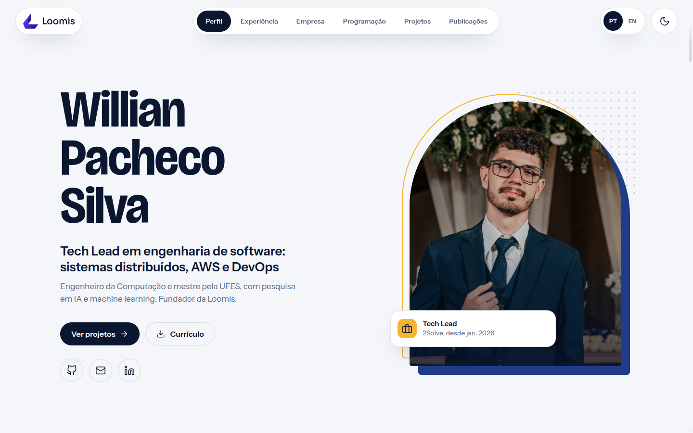
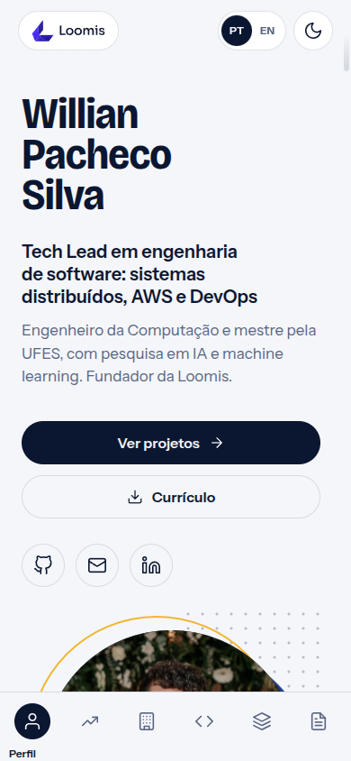

<div align="center">
    <br/>
    
    
    <br/>
</div>

<br/>

# Willian Pacheco Silva - Portfolio

Personal portfolio website with my background, skills, studies, publications and projects, in Portuguese and English, with light and dark themes.

Live site: [https://itswillian.github.io/](https://itswillian.github.io/)

## How it works

There is no build step. The browser loads `index.html`, which runs `app.js`:

| File | Role |
| --- | --- |
| `src/template.html` | The page markup, with `{{ placeholders }}` for the content |
| `src/portfolio.js` | The component: all content (PT/EN), state and interactions |
| `src/dc-lite.js` | Small runtime that fills the template and updates only what changed |
| `styles.css` | All styles, including the light and dark themes |
| `assets/` | Images, icons and the resume PDFs |
| `docs/` | Documents kept at their public URLs |

## Running locally

Modules and `fetch` need an HTTP server, so opening `index.html` directly does not work:

```sh
python3 -m http.server 8080
```

Then open [http://localhost:8080](http://localhost:8080).

## Deploy

GitHub Pages publishes the `main` branch from the repository root.
